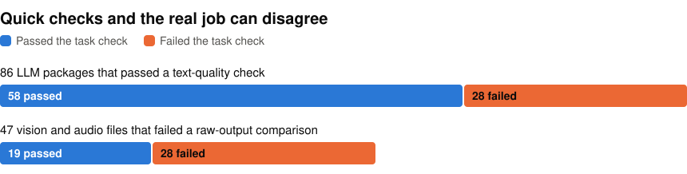

# Windows model zoo

146 test results showing whether converted LLM, vision and audio models still do their job on one Windows laptop. Each result runs one package once, untimed, on the Intel NPU, Intel GPU, NVIDIA RTX GPU or CPU. A pass means its output agrees with the original model in fp32, not that a person marked it right. A result covers only that package on that runtime and device, so it doesn't rate a model or a runtime overall.

<p align="center">
<picture>
  <source media="(prefers-color-scheme: dark)" srcset="https://raw.githubusercontent.com/john-rocky/windows-model-zoo/main/docs/images/results-dark.svg">
  
</picture>
</p>

My earlier repos, [windows-zoo](https://github.com/john-rocky/windows-zoo) and [windows-llm-zoo](https://github.com/john-rocky/windows-llm-zoo), used quick checks, so I judged two of their groups again on the model's actual job. Of 86 LLM packages whose text passed a text-quality check, 28 differed from the original model on more than 2 of 20 short questions. Of 47 vision and audio files that failed a comparison of raw output numbers, 19 still matched the original on boxes, points, masks or keywords. The 86 and the 47 are 133 of the results, so a package or file that ran on several runtimes or devices is counted each time. The other 13 run packages that neither earlier repo had: 4 run two of my own, Qwen3-1.7B and Qwen3-0.6B with int8 weights for the Intel NPU, on the NPU and the CPU; 3 run OpenVINO's int4 package of Qwen2.5-1.5B-Instruct on the CPU, the NPU and the Intel GPU; 3 run the Q4_K_M file of Qwen/Qwen2.5-1.5B-Instruct-GGUF through llama.cpp on the CPU and the NVIDIA RTX GPU (CUDA and Vulkan); and 3 run the Q4_K_M file of Qwen/Qwen2.5-0.5B-Instruct-GGUF the same way.

If you ship a converted model on Windows, look up the exact file you use. The model files stay on Hugging Face and in the Foundry Local catalog, and each model's `recipe.toml` says where they come from. If you converted your own model and have a Mac and a Windows PC, you can [add it](docs/add-a-model.md) and run the same checks.

## Look up a result

Each model has a folder in [`models/`](models/). The 146 results are the `task-*.json` files in its `results/` folder, one per runtime, device and package. For example, [`models/rtmpose_s_fp16/results/task-ovnpu.json`](models/rtmpose_s_fp16/results/task-ovnpu.json) is RTMPose-s through ONNX Runtime and OpenVINO on the Intel NPU, and its `line.verdict` field reads:

```text
FAIL on task-keypoints: 53 of 60 points shown by either side agree (pass mark 95 %)
```

The other files in `results/` are copied from the earlier repos and use their checks. 60 of them are Qualcomm AI Hub records from two other devices.

To get one table of every file, run this. It needs Python 3.11 or later and nothing else.

```bash
git clone https://github.com/john-rocky/windows-model-zoo
cd windows-model-zoo
python3 tools/table.py --local
```

It writes `RESULTS_LLM.md` and `RESULTS_VISION.md` on your disk.

## What's covered

| Job | Models |
|---|---|
| Text generation | [Qwen3 0.6B](models/Qwen3-0.6B/), [1.7B](models/Qwen3-1.7B/), [4B](models/Qwen3-4B/), [Gemma 4 E2B](models/gemma-4-E2B-it/), [E4B](models/gemma-4-E4B-it/), [Qwen2.5 1.5B Instruct](models/Qwen2.5-1.5B-Instruct/), [0.5B](models/Qwen2.5-0.5B-Instruct/) |
| Object detection | [D-FINE-S](models/dfine_graphB_fp16/) ([fixed](models/dfine_graphB_fp16_fixed/)), [RT-DETRv2-S](models/rtdetr_graphB_fp16/) ([fixed](models/rtdetr_graphB_fp16_fixed/)), [SSDLite MobileNetV3](models/ssdlite_mobilenetv3_320_fp16/) |
| Text and line-segment detection | [PP-OCRv5](models/ppocr_det_fp16/), [M-LSD-tiny](models/mlsd_fp16/) |
| Pose and keypoints | [RTMPose-s](models/rtmpose_s_fp16/), [RTMW-m whole body](models/rtmw_fp16/), [RTMPose hand](models/rtmhand_fp16/), [face](models/rtm_face_fp16/), [animal](models/rtm_animal_fp16/) |
| Segmentation | [SAM 2](models/sam2_decoder/) ([fixed](models/sam2_decoder_fixed/)), [SINet-V2](models/sinet/) |
| Depth | [Metric3D v2](models/metric3d_fp16/) |
| Other image tasks | [DINOv2 ViT-S/14](models/dinov2_s_fp16/), [DewarpNet](models/dewarp/), [DM-Count](models/dmcount/) |
| Video | [MoViNet-A0](models/movinet_a0_stream/) |
| Audio | [wav2vec2 keyword spotting](models/w2v2_head_fp16/) ([frontend](models/w2v2_frontend_fp16/)), [DAC 16 kHz](models/dac_16khz_deconly_zs_fp16/) |

"Fixed" marks a file converted again with a change to tf2onnx, which [windows-zoo](https://github.com/john-rocky/windows-zoo) describes.

The 146 results ran on an MSI Stealth 16 AI+ laptop with an Intel Core Ultra 9 386H, an NVIDIA RTX 5080 Laptop GPU, 31.5 GiB of RAM and Windows 11. Of these, 102 ran on 2026-11-10. Another 31, all on the Intel NPU, ran again on 2026-11-11 after an update to NPU driver 32.0.100.5540, with the same verdicts as on 2026-11-10. The 4 int8 results and 2 Qwen2.5-1.5B-Instruct results ran on 2026-11-12, and 7 more on 2026-11-13: 4 of Qwen2.5-1.5B-Instruct (1 on the Intel GPU and 3 through llama.cpp) and 3 of Qwen2.5-0.5B-Instruct through llama.cpp.

The runtimes were ONNX Runtime 1.31.1 with its CUDA and OpenVINO execution providers, OpenVINO and OpenVINO GenAI 2026.4.1, ONNX Runtime GenAI 0.19.0, LiteRT-LM v0.19.0, llama.cpp b11721 and Foundry Local 0.13.0.

## How a result is judged

An LLM package answers 20 short questions with greedy decoding. It passes when the first line of at least 18 answers matches the same model in Transformers on the CPU, and one extra prompt ends within 16 tokens. Gemma 4 E4B's reference runs in bf16, because its fp32 weights would take 29.8 of the laptop's 31.5 GiB.

A vision or audio file runs on a fixed input set. Its output goes through a copy of the sample app's post-processing and is compared with the model's fp32 file on the CPU, for example boxes by overlap and points by distance.

I fixed the pass marks before running these results. The earlier repos' quick checks are simpler: the text-quality check looks at length, vocabulary and repetition, and the raw-output comparison looks at cosine similarity and argmax agreement. [PLAN.md](PLAN.md) has every rule, and [docs/reading-results.md](docs/reading-results.md) explains the fields in a result file.

## Run it yourself

The tools run on a Mac and drive a Windows PC over SSH. [docs/reproduce.md](docs/reproduce.md) has the commands to rebuild results from an empty folder. Running them again reproduced the same verdicts and numbers for every result tried so far, 9 on the first pass and 19 on the second ([log](WALK.md)).

## Limits

- All 146 results come from one laptop.
- Speed values in the `task-*` files come from single untimed runs. Don't use them as timings.
- The LLM check counts agreement, and the original model can be wrong. In fp32, Qwen3-0.6B answers 1 to "How many days are in a week?" [PLAN.md](PLAN.md#how-to-read-the-qa20-line) says what the check counts.
- A FAIL doesn't say what caused it.

## Licence

[LICENSES.md](LICENSES.md) lists each model's licence and the input sets' terms. This repo's own code and records have no licence file yet.
