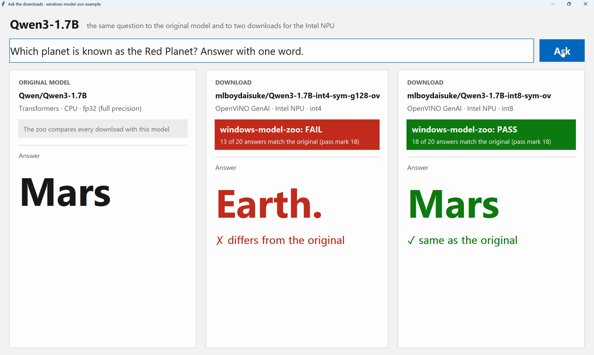

# Ask the downloads

A small Windows app that asks one question to a model's original weights and to downloads of the same model, side by
side. Each download is a package on the Hugging Face Hub. The app gives each one a card that shows its
[windows-model-zoo](../../README.md) result next to the answer it gives.



## Run it

You need Windows 11 with an Intel NPU, git, [uv](https://docs.astral.sh/uv/) on PATH and Smart App Control not on,
as [When it does not work](#when-it-does-not-work) explains. You do not need to install Python: uv downloads Python
3.12 when the PC has no 3.12. It was checked on one laptop, an Intel Core Ultra 9 386H with 31.5 GiB of RAM, where
the app's processes used up to 12.6 GiB together. Disk: the `work` folder was 9.0 GB after setup, 8.0 GB of it model
files. uv's package cache and the caches OpenVINO writes at the first start come on top.

```powershell
git clone https://github.com/john-rocky/windows-model-zoo
cd windows-model-zoo\examples\ask-downloads
powershell -ExecutionPolicy Bypass -File setup.ps1
work\venv-ovg\Scripts\python.exe ask_downloads.py --scene scene_npu.json
```

Run them inside the clone: `setup.ps1` and the app read the repo's own files two folders up, such as `pc/fetch.py`,
the questions and the results. `scene_npu.json` is a scene: a JSON file that names the cards, described below.

Each card says `ready` when its model is loaded and warmed up. On that laptop the first start took 100 s
until every card was ready, later starts 12 to 20 s, and the first start after the laptop had restarted 54 s. Ask works
once no card is still loading or warming up and the original model's card says `ready`: every card's prompt comes
from that card.

`setup.ps1` makes two Python 3.12 venvs with the package versions of the zoo's runs, listed in `req-ovg.txt` and
`req-ref.txt`. It downloads the files of `hub_manifest.json` at the revisions it names, and the zoo's `pc/fetch.py`
checks each file against the hash the manifest holds for it: the Hub's sha256 for a file kept in Git LFS, the git blob
hash for the others. It also downloads llama.cpp b11721 for the CPU and checks it with `llama_cpu.json`.

## Ask

Type a question and press Ask. Every card gets the same prompt: the original model's chat template turns the question
into it one time, with thinking off (`enable_thinking=False`), and no runtime adds a template of its own. Each card
decodes it greedily, for at most 48 new tokens, as the zoo's own runs do for its 20 questions.

A download's card says `same as the original` when the first line of its answer is the same as the original model's,
and `differs from the original` when it is not. They are compared the way the zoo's 20-question check, `qa20`,
compares them: the first line in lower case, without quotes, backticks or asterisks around it, without a final . ! ?
and with spaces collapsed.

The same answer is not always a right one, and a different answer is not always wrong. To the zoo's question "What
color do you get by mixing blue and yellow? Answer with one word." the original model answers "Yellow." and both NPU
downloads answer "Green." [PLAN.md](../../PLAN.md#how-to-read-the-qa20-line) says what the check counts.

## When it does not work

- **No Intel NPU**: not tried on such a PC. A card whose device OpenVINO does not know shows OpenVINO's error (with a
  made-up device name: `error: load: RuntimeError: Device with "NOSUCHDEVICE" name is not registered in the OpenVINO
  Runtime`), and the other cards still answer. To run the int8 download on the CPU instead, copy the scene and change
  that card: `worker.device` to `CPU`, `worker.cache_dir` to a new folder, `engine` (the text under the card's name)
  to say CPU, and `zoo_cell` to `{ZOO}/models/Qwen3-1.7B/results/task-openvino-genai_cpu_cpu-int8-sym.json` (`{ZOO}`
  is the repo's root). For the int4 download, change the first three the same way and delete its `zoo_cell` entry:
  the zoo has no CPU result for it, and the app has not run it on the CPU.
- **The original model's card fails**: the card says `could not start: FileNotFoundError: [WinError 2] …` when its
  Python is missing, or `error: load: OSError: Repo id must be in the form 'repo_name' or 'namespace/repo_name': …`
  when its model folder is missing. The other cards say `not asked: every card's prompt comes from the original
  model's card`. Run `setup.ps1` again.
- **`setup.ps1` stopped part-way**: run it again. It checks each file and downloads only what is missing or does not
  match. On the laptop above, a second run after a full setup took 16 s and made nothing.
- **uv is not on PATH**: `setup.ps1` stops with `uv.exe not found: install it first (winget install astral-sh.uv),
  then run this again`.
- **A download the zoo has no result for**: its card says `Not in windows-model-zoo yet: no result for this download
  on this device`. It still answers, and its answer is still compared with the original's.
- **Smart App Control is on** (Windows 11): the zoo's [guide](../../docs/reproduce.md) lists it not on as a need and
  says that, while it is on, Windows blocks the `python.exe` uv puts in each venv. `setup.ps1` was not run with it
  on. On the laptop above, with it on and with the venvs `setup.ps1` had made on 2026-11-12, the app started through
  `python.exe` on 2026-11-14 and both NPU cards answered. Windows blocked llama.cpp's `llama-server-impl.dll`, and
  the GGUF card said `error: load: RuntimeError: llama-server exited 0xC0E90002 while loading: Windows blocked one of
  its files (an app control policy such as Smart App Control)`.

## What the cards show

- The first card is the original model, run by Transformers on the CPU in fp32. It is the reference the zoo compares
  every download with.
- Each other card is one download in its own runtime and device. Its badge is that download's result in the zoo's
  `qa20` check: PASS or FAIL, and how many of its 20 answers have the same first line as the original model's. The
  pass mark is 18, and the [README](../../README.md#how-a-result-is-judged) has the whole rule.

Two scenes come with it:

- `scene_npu.json`: the original Qwen3-1.7B, `mlboydaisuke/Qwen3-1.7B-int4-sym-g128-ov` on the Intel NPU and
  `mlboydaisuke/Qwen3-1.7B-int8-sym-ov` on the Intel NPU.
- `scene_gguf.json`: the original Qwen3-1.7B, the int4 download on the Intel NPU and `unsloth/Qwen3-1.7B-GGUF` in
  Q4_K_M with llama.cpp on the CPU.

To compare another download, get its files yourself: `setup.ps1` downloads only the files in `hub_manifest.json`.
Then copy a scene and change one card. No download other than the three above has been run in the app.

- `name` and `engine` are the texts on the card.
- `worker.model_dir` is the OpenVINO folder, for a card of kind `ovg`. A card of kind `llama` takes the GGUF file in
  `worker.model`. `{ROOT}` is the `work` folder.
- `zoo_cell` is the download's `task-*.json` under `models/`. Without it, the card says the zoo has no result.

## Checked on

All on the laptop the zoo's results ran on: an Intel Core Ultra 9 386H with 31.5 GiB of RAM and Windows 11.

- 2026-11-12: for the zoo's 21 `qa20` prompts, the 20 questions and one extra prompt, every card of both scenes gave
  the same new token ids as the zoo's records: the original model's
  ([record](../../raw/llm-qa20/refs/Qwen3-1.7B/ref.json); `raw/npu-rerun/refs/` holds the same file), the
  [int4 download's](../../raw/npu-rerun/runs/npu-rerun-b/Qwen3-1.7B/task-openvino-genai_npu_npu-sym-g128/run1.json), the
  [int8 download's](../../raw/qwen3-int8-sym/runs/qwen3-int8-sym-n/Qwen3-1.7B/task-openvino-genai_npu_npu-int8-sym/run1.json) and the
  [GGUF download's](../../raw/llm-qa20/runs/llm-qa20-c-q17/Qwen3-1.7B/task-llama.cpp_cpu_cpu/run1.json).
- 2026-11-14, with Smart App Control on: the GGUF card's message above.
- 2026-11-16, with Smart App Control off and Intel NPU driver 32.0.100.5540: `setup.ps1` ran as written above in a
  fresh copy of this repo (unpacked from an archive, not cloned), and a second run found everything there. The app,
  started as above with `--autoplay` (the 21 prompt ids), `--run-dir` and `--exit-after` added, gave the same new
  token ids as the zoo's records in both scenes again. Each case of "When it does not work" that quotes a message gave
  that message. The Smart App Control one is from 2026-11-14.
